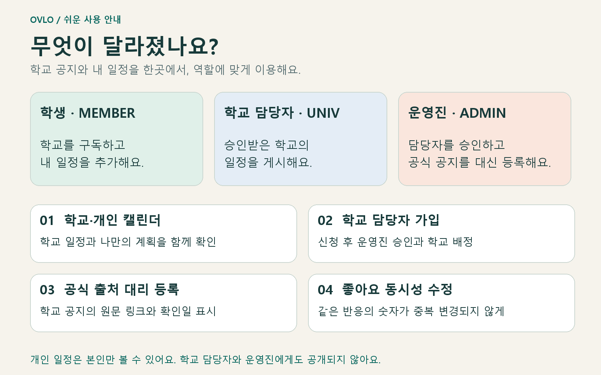
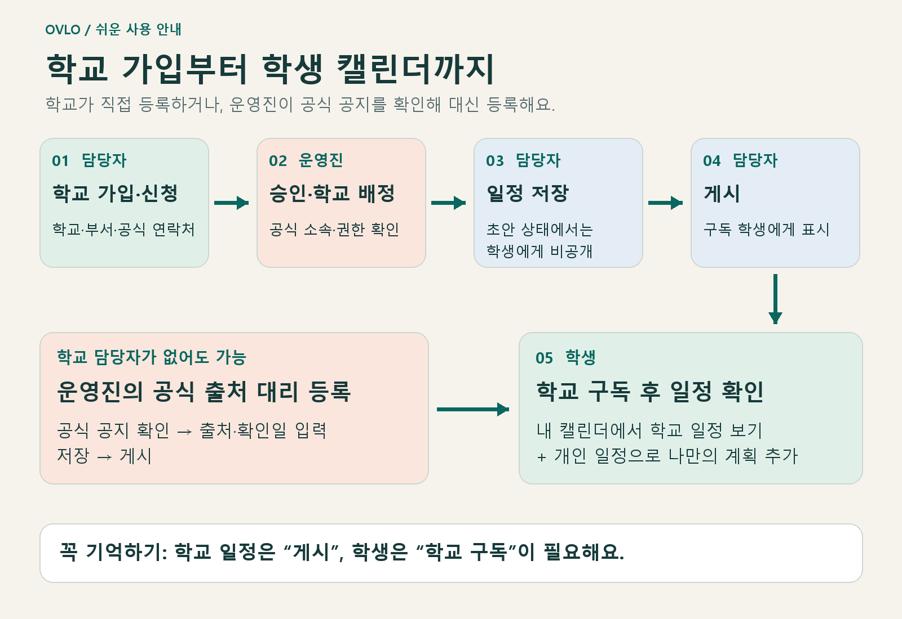
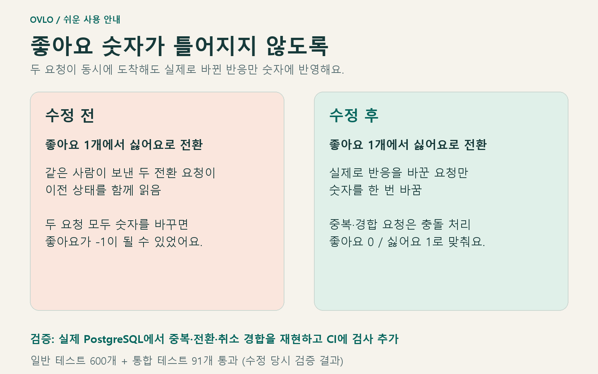

# Ovlo 캘린더·학교 담당자 사용 가이드

학교 소식과 개인 일정을 한곳에서 확인하는 방법을 설명합니다. 2026-11-10 한국어 화면 기준이며, 그림은 실제 버튼명과 동작을 반영한 **안내용 도식**입니다. 실제 화면 캡처가 아니며 예시 일정은 공식 공지가 아닙니다.

- [쉬운 설명 PDF 내려받기](ovlo-calendar-guide-ko.pdf)
- [기능·권한·API 설계 문서](../calendar.md)
- 서비스: [ovlo.mungji.com](https://ovlo.mungji.com)

## 무엇이 달라졌나요?

학교 담당자는 승인받은 학교의 일정을 등록하고, 학생은 구독한 학교의 일정과 자기 일정을 같은 캘린더에서 볼 수 있습니다. 학교가 직접 등록하지 않아도 운영진이 공식 공지를 확인해 출처와 함께 등록할 수 있습니다.

| 사람 | 할 수 있는 일 |
|---|---|
| 일반 회원·학생 (`MEMBER`) | 학교 구독, 학교 일정 확인, 개인 일정 관리, 담당자 신청 |
| 승인된 학교 담당자 (`UNIV`) | 일반 회원 기능 + 배정된 학교의 일정 작성·게시·취소 |
| 운영진 (`ADMIN`) | 담당자 확인·승인·배정 해제, 공식 출처 기반 일정 대리 등록 |

개인 일정은 본인만 볼 수 있습니다. 학교 담당자와 운영진도 다른 사람의 개인 일정을 볼 수 없습니다.

## 전체 사용 순서

**담당자 신청 → 운영진 승인·학교 배정 → 일정 저장 → 게시 → 학생의 학교 구독·확인** 순서입니다. 학생이 먼저 구독해 두어도 됩니다. 일정이 게시되고 학생이 학교를 구독한 상태라면 다음 캘린더 조회에 표시됩니다.

학교 담당자가 없을 때는 운영진의 공식 출처 기반 대리 등록으로 시작할 수 있습니다.

## 1. 학교 담당자 가입·신청

1. [회원가입](https://ovlo.mungji.com/register)에서 **학교 담당자 가입**을 선택합니다.
2. 담당자 이름·닉네임·학교 업무 이메일·비밀번호를 입력합니다.
3. **학교 검색**으로 학교를 찾고 검색 결과에서 학교를 선택합니다.
4. **담당 부서**와 **담당 업무와 확인 가능한 공식 연락처·안내**를 작성합니다. 예: 국제교류처, 학교 직원 안내 페이지, 맡은 업무.
5. **계정 만들고 담당자 신청**을 누릅니다.
6. **로그인하고 신청 확인**으로 이동해 **내 신청 내역**을 확인합니다.

신청 직후에는 일반 회원이며, 신청 상태는 **검토 대기**입니다. 비밀번호나 신분증을 담당 업무 설명에 넣지 마세요. 승인 전에도 일반 회원 기능을 이용할 수 있습니다.

이미 계정이 있다면 새 계정을 만들지 않고 [담당자 신청·상태 확인](https://ovlo.mungji.com/university-account)에서 신청합니다. 반려·권한 해제 시 사유를 확인한 뒤 같은 화면에서 다시 신청할 수 있습니다.

## 2. 운영진의 담당자 승인

1. [관리자 로그인](https://ovlo.mungji.com/admin/login) 후 **학교 일정 · 담당자** 메뉴를 엽니다.
2. **학교 담당자 신청**에서 상태 `PENDING`을 선택하고 **조회**합니다.
3. 학교 공식 직원 안내나 연락처로 신청자의 소속과 업무 권한을 확인합니다.
4. **확인 근거 / 사유**를 입력하고 **승인·학교 배정**을 누릅니다.
5. 담당자는 신청 화면에서 **새로고침 → 승인됨 → 학교 일정 관리하기**로 이동합니다.

승인은 역할과 학교 배정을 함께 처리합니다. 회원 역할만 `UNIV`로 바꾸면 관리 학교가 생기지 않습니다. 거절은 **반려**, 이미 승인한 담당자의 권한 회수는 `APPROVED` 목록의 **학교 권한 해제**를 사용합니다.

## 3. 학교 일정 작성·게시

1. [학교 일정 관리](https://ovlo.mungji.com/calendar/manage)에서 **관리 학교**를 선택합니다.
2. **+ 학교 일정**을 누릅니다.
3. 제목·분류·일정 종류·기간을 입력합니다. 필요하면 장소·신청 마감·신청 링크·대상·설명을 더합니다.
4. 시간 지정 일정은 **기준 시간대**도 확인합니다. 한국 학교는 일반적으로 `Asia/Seoul`입니다.
5. **저장**하면 초안이 만들어집니다.
6. 아래 일정 목록에서 해당 항목을 선택하고 **게시**를 누릅니다.

**저장만 하면 학생에게 보이지 않습니다. 게시까지 해야 합니다.**

입력 예시(실제 공지가 아님): 제목 ‘비자 연장 서류 접수’, 분류 ‘행정 · 비자’, 일정 종류 ‘종일’, 시작일 11월 20일, 마지막 날 11월 22일. **마지막 날 (포함)**에는 실제 마지막 날짜를 넣으면 됩니다. 하루 일정은 시작일과 마지막 날을 같은 날짜로 입력합니다.

게시 후에는 **수정**으로 변경할 수 있습니다. 행사가 취소되면 **행사 취소**를 눌러 학생에게 취소 상태를 알립니다. 초안은 **삭제**할 수 있습니다. 게시한 일정의 수정·취소는 학생이 다음에 조회할 때 반영됩니다.

## 4. 학생의 학교 일정 확인

1. 로그인 후 상단 또는 모바일 메뉴의 [캘린더](https://ovlo.mungji.com/calendar)를 엽니다.
2. **학교 구독**을 누르고 학교를 검색·선택합니다.
3. **이 학교 구독**을 누릅니다. 추천 학교가 보이면 **+ 학교명**으로도 구독할 수 있습니다.
4. 조회 월을 맞추고 일정 목록의 항목을 눌러 상세 내용을 확인합니다.
5. 필요하면 **학교 일정**, **행정 · 비자**, **학사**, **행사** 필터 또는 **목록 보기**를 사용합니다. 모바일에서는 일정 목록 중심으로 확인합니다.

프로필의 학교 선택과 캘린더 구독은 별개입니다. 학교 소속 여부와 관계없이 구독할 수 있으며, 구독이 학교 담당자 권한을 주지는 않습니다. 구독 해제는 **학교 구독** 영역의 **학교명 ×**를 누릅니다.

| 학생에게 보이는 표시 | 의미 |
|---|---|
| 학교 담당자 등록 | 승인된 학교 담당자가 등록한 일정 |
| Ovlo 등록 · 학교 공식 공지 참고 | 운영진이 학교 공식 공지를 확인하고 대리 등록한 일정 |
| 개인 · 나만 보기 | 내가 작성한 개인 일정 |
| 취소됨 / 취소된 일정입니다. | 게시 후 취소된 학교 일정 |

신청이 필요한 행사는 상세의 **신청 · 관련 페이지 ↗**를 이용합니다. 캘린더에서 일정을 보는 것만으로 신청이 완료되지는 않습니다.

## 5. 개인 일정 추가·수정·삭제

1. [내 캘린더](https://ovlo.mungji.com/calendar)에서 **+ 개인 일정**을 누릅니다.
2. 제목·기간·설명 등을 입력하고 **저장**합니다.
3. 개인 일정은 별도의 게시 과정 없이 표시됩니다.
4. 일정 목록에서 선택한 뒤 **수정** 또는 **삭제**를 사용합니다.

예: 대사관 방문, 서류 준비, 친구와 약속. 학교 일정과 같은 캘린더에 보여도 개인 일정은 다른 사람에게 공유되지 않습니다.

## 6. 운영진의 공식 출처 기반 대리 등록

학교 담당자의 가입·승인이 없어도 운영진은 등록할 수 있습니다.

1. [학교 일정 · 담당자](https://ovlo.mungji.com/admin/calendar)의 **학교 공식 일정 대리 등록**으로 이동합니다.
2. **학교 검색 → 검색 → 학교 선택** 후 조회 월과 기존 일정을 확인해 중복 등록을 피합니다.
3. **새 일정 초안**에 제목·분류·기간·기준 시간대·안내 요약 등을 입력합니다.
4. **공식 출처 링크**에 학교 공식 홈페이지의 해당 공지 주소를 입력합니다.
5. **출처 확인일**에 원문을 실제 확인한 날짜를 입력합니다. 두 항목 모두 필수입니다.
6. **저장** 후 생성된 일정의 **게시**를 누릅니다.
7. 학생 계정에서 해당 학교를 구독하고 일정·원문 링크·출처 확인일이 표시되는지 확인합니다.

관리자 화면의 분류: `ADMINISTRATION` = 행정·비자, `ACADEMIC` = 학사, `EVENT` = 행사, `OTHER` = 기타.

학생에게는 **Ovlo 등록 · 학교 공식 공지 참고**로 표시되고, 상세의 **학교 공식 출처 ↗**로 원문을 볼 수 있습니다. 링크를 넣는다고 내용이 자동 수집되거나 갱신되지는 않습니다. 변경 공지가 있으면 운영진이 직접 수정하며, **출처 재확인 필요** 안내가 보이면 원문을 확인한 뒤 내용과 확인일을 갱신합니다.

## 이번에 함께 고친 좋아요 문제

같은 사람이 짧은 순간에 중복 요청을 보내면 두 요청이 모두 성공했다고 처리될 수 있었습니다. 좋아요에서 싫어요로 동시에 바꾸는 경우에는 숫자가 두 번 바뀌어 좋아요가 -1이 되는 문제도 재현됐습니다.

이제 실제 반응을 바꾼 요청만 숫자를 바꿉니다. 중복·경합 요청은 충돌로 처리해 중복 집계를 막습니다. 저장된 반응과 숫자가 맞는지 실제 PostgreSQL 회귀 테스트로 검사하며 CI에서도 실행합니다. 수정 당시 일반 테스트 600개, 통합 테스트 91개가 모두 통과했습니다.

## 막힐 때 확인할 것

| 상황 | 확인 방법 |
|---|---|
| 학교 일정을 등록할 수 없음 | 신청이 **승인됨**인지, **관리 학교**에 해당 학교가 배정됐는지 확인 |
| 학생에게 일정이 보이지 않음 | **게시** 여부 → 학교 구독 → 조회 월·선택 날짜·필터 순서로 확인 |
| 다른 날짜가 표시됨 | 종일/시간 지정 여부와 기준 시간대를 확인 |
| 저장 중 변경 충돌 안내 | 화면을 새로고침하고 최신 내용을 확인한 뒤 다시 수정 |
| 공식 출처 입력 오류 | URL과 확인일을 함께 입력했는지 확인 |

현재 1차 기능에는 푸시 알림, 반복 일정, 외부 캘린더 동기화, 자동 공지 수집, 자체 참가 신청이 포함되지 않습니다. 캘린더와 원문 공지를 직접 확인해 주세요.

## 구현·검증 근거

- [캘린더·학교 가입 PR #66](https://github.com/yeonjae1220/Ovlo/pull/66): 실제 가입·승인·학교 일정 게시·학생 표시·개인 일정·출처 표시 검증.
- [좋아요 동시성 수정 PR #67](https://github.com/yeonjae1220/Ovlo/pull/67): 경합 재현, 저장 원자성 수정, CI 회귀 검사 추가.
- [프로젝트 지침 갱신 PR #68](https://github.com/yeonjae1220/Ovlo/pull/68).

그림과 PDF 재생성 방법은 [생성 스크립트](generate_calendar_guide.py)의 설명을 참고하세요.
